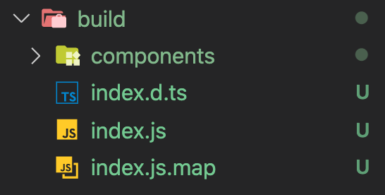
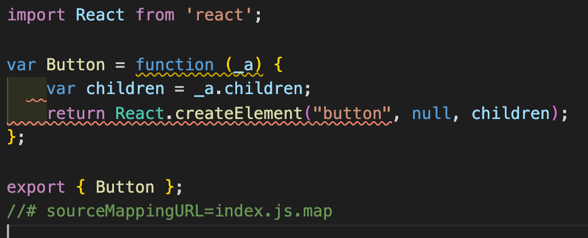
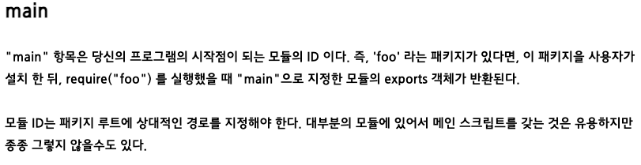
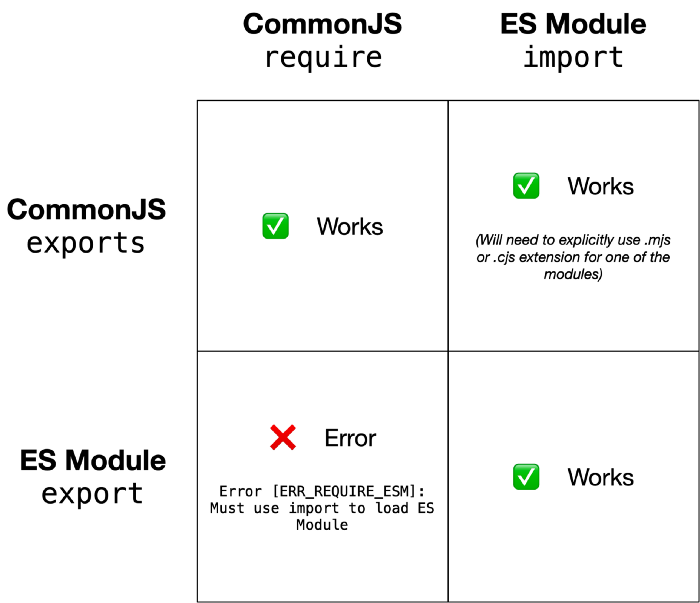
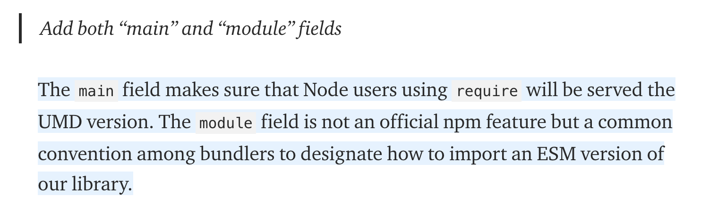

## 개요

언젠가 나만의 라이브러리를 만들어 배포하고 싶다는 생각을 갖고 있다가 이번에 디자인 시스템 개발에 도전하게 되었습니다. 리액트 컴포넌트 기반의 디자인 시스템 개발 자료를 찾아보던 중, `Typescript` + `Storybook` + `React`를 활용하여 개발을 진행하고 웹팩 대신 `Rollup`으로 빌드하여 npm으로 배포한다는 블로그 글을 많이 찾게 되어 도전해 보기로 했습니다.

## Rollup ?

`Typescript` , `Storybook` , `React`는 기존 프론트 개발을 하면서 많이 사용해 보아서 익히 알고 있었지만, 웹팩 말고 Rollup은 처음이었습니다. 내가 아는 번들러는 웹팩이 유일했는데, Rollup은 어떤 역할을 하는 도구일까요?

라이브러리를 배포하려면 보통 webpack과 같은 도구로 라이브러리도 번들링을 해주어야 합니다. 번들링은 필수는 아니며 TypeScript 또는 Babel로 코드를 트랜스파일해서 등록을 할 수도 있습니다.

그럼 번들링 도구로 webpack을 쓸 수도 있는데 Rollup을 쓰는 이유는 무엇일까요?

webpack은 ES Module 형태로 번들을 할 수 없습니다. webpack을 사용할 때에는 일반적으로 commonjs 형태로 번들링을 하게 되는데, commonjs로 번들링한 라이브러리를 나중에 다른 프로젝트에서 사용하게 되면 Tree-Shaking을 지원하지 않는다고 합니다.

그럼 Tree-Shaking은 무엇일까요?

<aside>
💡 배포한 라이브러리를 설치하고 그 중에서 Button 컴포넌트만 사용한다고 할 때, Tree-shaking이 되었다면 프로젝트를 빌드할 때, Button 컴포넌트 외에 다른 컴포넌트를 사용하지 않았기 때문에 빌드된 파일에도 다른 컴포넌트와 관련된 코드가 포함되지 않게 된다. 즉, 사용한 컴포넌트만 코드에 포함됩니다.

</aside>

<br/>

🚀 **참고**

[(Webpack 2) 트리 쉐이킹을 해보자!](https://perfectacle.github.io/2017/03/12/webpack2-tree-shaking/)

그렇다면 ES Module 형태로 배포하는 것이 좋다는 결론에 도달합니다.

## 시작하기

```jsx
// rollup.config.js
output: [
    {
      file: 'build/index.js',
      format: 'es',
      sourcemap: true,
      exports: 'named',
    },
  ],
```

rollup.config.js의 output에서 format을 'es'로 설정하면 ES Module 형태로 번들링됩니다.





빌드하면 `export`를 사용하여 위와 같이 직접 만든 Button 컴포넌트를 내보냅니다.

이제 `npm publish`로 배포한 뒤 CRA(create-react-app)와 CNA(create-next-app)를 이용해서 프로젝트를 생성하고, 직접 만들어 배포한 라이브러리를 설치해서 Button 컴포넌트를 제대로 불러오는지 실험해 보았습니다. 그런데 `Unexpected token 'export'...` 에러가 발생했습니다...😇

설정을 잘못한 것인지 원인을 파악해 보기 시작했습니다.

내가 설정을 잘못했는지 확인하기 위해 여러 다른 라이브러리를 찾아보던 중 [class101 ui](https://ui.class101.dev/) 라는 **클래스101** 에서 개발한 디자인 시스템을 발견했습니다. 이 라이브러리도 rollup으로 빌드해서 배포한 것이라 동일하게 CRA와 CNA 프로젝트에 설치하여 컴포넌트를 불러온 결과는 역시 마찬가지였습니다...

그럼 다른 라이브러리는 괜찮은지 확인하기 위해 `Antd` 와 `Material-ui` 를 설치해서 실험해 보았습니다.

실험 결과, 두 라이브러리 모두 정상 동작했습니다.

이후에도 계속 다른 블로그들을 찾아보며 여러 설정을 바꿔 본 결과, `ES Module`로 빌드하여 배포한 것은 CNA에서 이상하게도 에러를 뱉어내고 `CommonJS` 형태로 빌드한 것은 잘 동작한다는 것을 실험을 통해 알게 되었습니다.

그럼 유명 라이브러리와 직접 배포한 라이브러리의 차이는 무엇일까요?

차이를 알아보기 위해 여러 시행착오를 거쳤습니다. 해당 라이브러리를 뜯어보고, 평소에는 그냥 모르고 지나쳤던 node의 package 관리에 대한 정보를 찾아보며 무엇이 문제였는지 알아보았습니다.

여러 라이브러리 배포에 대해 포스팅한 블로그를 살펴보았고, 그중 rollup으로 배포를 시도한 몇몇 포스팅에서는 cjs와 esm 모두 빌드하고 package.json의 main에는 cjs의 경로를, module에는 esm의 경로를 지정하는 것을 발견하였습니다.

둘 중 하나도 아니고 둘 다 빌드를 합니다. 그럼 ES Module 프로젝트이면 esm으로 빌드된 코드를 가져오고, CommonJS 프로젝트에서는 cjs 코드를 가져온다는 의미일까요? 어떻게 동작하는 것일까요?

라는 궁금증이 생겼습니다. 하나를 알려고 파고들수록 계속 궁금한 것이 늘어만 갔습니다...☠️

먼저, package.json의 main이라는 키값에 대한 설명을 찾았습니다.<br/><br/>

<br/>

이처럼 package.json에서 main은 디렉토리가 위치한 엔트리 포인트를 나타냅니다. 즉, 이 패키지의 메인 파일명에 대한 지정을 나타냅니다. 따라서, 빌드한 결과물인 index.js에 대한 경로를 적어주면, 라이브러리를 import 하거나 require 할 때 main에 적혀 있는 파일을 참조하여 가져옵니다.

그럼 만약 프로젝트가 ES Module로 작성된 프로젝트라면 어떻게 될까요? package.json의 main에 cjs 경로를 적어주고 module에 esm 경로를 적어주었으니 알아서 자동으로 module에 적혀 있는 esm을 가져다 쓰는 것일까요?

그래서 직접 실험을 시작했습니다...

먼저, 프로젝트에 `const { Button } = require('my-library')` 를 삽입하고 어떤 것을 참조하는지 확인했습니다.

당연하게도, package.json의 main에 설정해두었던 경로를 참조합니다.

두 번째로, package.json에 `"type" : "module"` 로 지정하여 ES Module을 사용하는 프로젝트를 하나 만들어 `import { Button } from 'my-library'` 해보고 어떤 것을 참조하는지 확인했습니다.

그런데 package.json의 module이 아니라 main인 cjs 코드를 참조했습니다...

그럼 어떻게 동작하는 것일까요? 그리고 ES Module 프로젝트인데 cjs 코드를 가져다 임포트시켜도 동작합니다.

궁금증이 계속해서 추가되었습니다...

일단 알게 된 ES Module과 CommonJS의 차이점입니다.<br/><br/>

<br/><br/>

[Using ES modules with CommonJS modules in Node.js](https://pencilflip.medium.com/using-es-modules-with-commonjs-modules-in-node-js-1015786dab03)<br/><br/>

CommonJS는 어디서든 모두 사용 가능했습니다.

그럼 cjs로만 빌드해서 사용하면 될까요? 하지만 그렇게 하면 Tree-Shaking이 되지 않습니다.

포기할 뻔했지만, 끈기를 가지고 다시 도전했습니다!!!🔥

그러다 package.json의 main과 module의 차이점에 대한 포스팅을 발견했습니다!!<br/><br/>

[What is the "module" package.json field for?](https://stackoverflow.com/questions/42708484/what-is-the-module-package-json-field-for)

[Code-splitting for libraries-bundling for npm with Rollup 1.0](https://levelup.gitconnected.com/code-splitting-for-libraries-bundling-for-npm-with-rollup-1-0-2522c7437697#9f6f)<br/><br/>

<br/>

아! `module`은 공식적인 필드는 아니지만, 나중에 번들러가 참조하는 필드였습니다!!!

이제야 이해가 되기 시작합니다...

어디서든 실행 가능하도록 main은 cjs를 가리키게 하고, 프로젝트를 빌드할 때 번들러가 `module`을 참조하는 방식이었습니다.

지금까지 알아낸 결과를 정리하면 다음과 같습니다.

1. cjs로 만든 라이브러리는 프로젝트에서 import/export로 불러오고 내보낼 수 있습니다. (단, esm으로 작성된 라이브러리는 require로 불러올 수 없습니다.)
2. 그러면 라이브러리를 만든다면 대부분 지원되는 cjs로 배포하는 것이 이득일까요?
3. 하지만 cjs는 트리 쉐이킹이 되지 않습니다.
4. 그럼 어떻게 해야 할까요?
5. 라이브러리 A를 만들 때 cjs 버전과 esm 버전을 둘 다 만들고, package.json에 module이라는 키를 추가해 값으로 esm 경로를 지정합니다. main은 cjs 경로를 가리킵니다.
6. 프로젝트에 라이브러리 A를 설치하고 모듈들을 사용합니다. (import로 불러오든 require로 불러오든 상관없습니다.)
7. 프로젝트를 완성한 뒤 웹팩 같은 번들러로 빌드할 때 라이브러리 A의 package.json의 module을 참고해서 esm 형식을 참조하게 되고, 트리 쉐이킹이 가능해져서 현재 프로젝트에서 라이브러리 A에서 사용한 부분만 골라서 빌드합니다!

끝!
