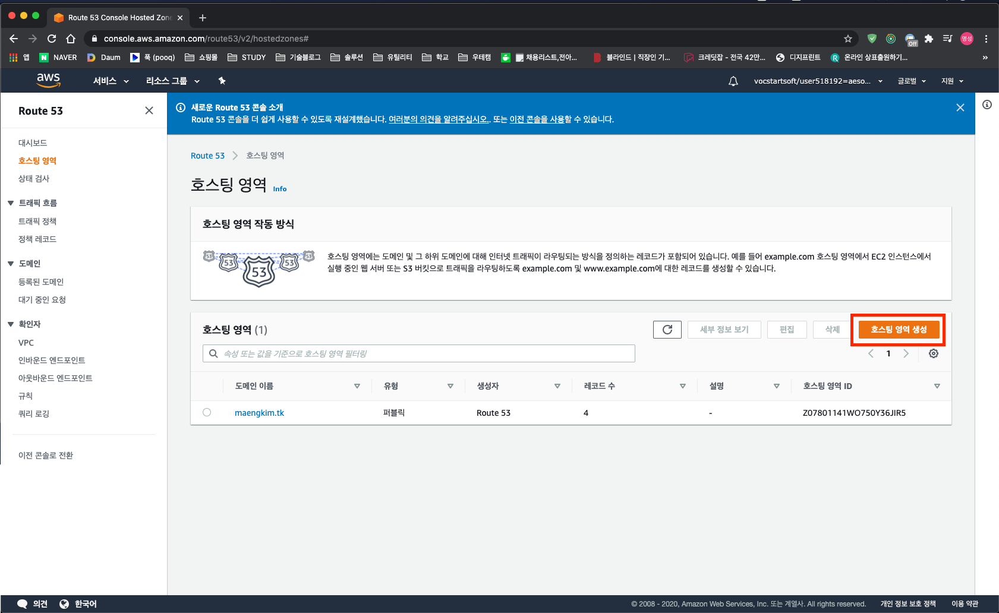
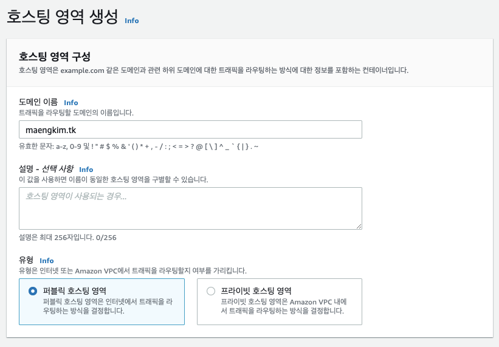
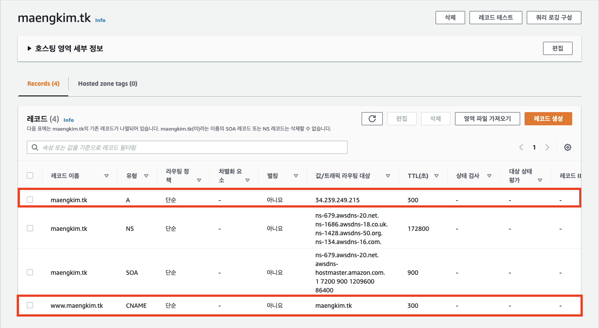
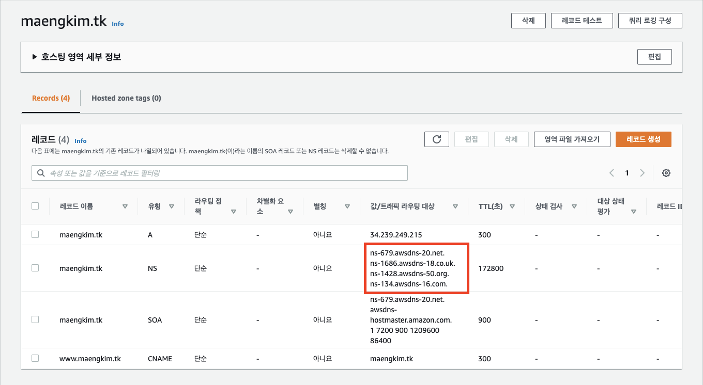
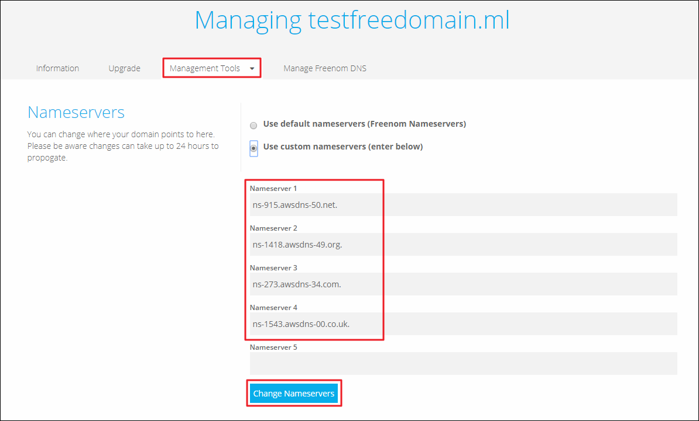

## 도메인

도메인은 사이트를 구분하는 글자입니다. 다른 사람이 사이트를 찾아갈 수 있도록 도메인이라는 "인터넷 주소"가 필요합니다.

## 무료 도메인 사이트

[Freenom - A Name for Everyone](https://www.freenom.com/en/index.html?lang=en)

(.tk .ml .ga .cf .gq) 무료 도메인을 만들 수 있습니다.

## 도메인 연결

Route 53에 호스팅 영역을 생성합니다.

 

구매한 도메인을 입력합니다.

 

레코드를 생성합니다. 유형 A에는 인스턴스 퍼블릭 IP 주소를 값으로 입력하고, 유형 CNAME에는 도메인 주소를 값으로 입력합니다.

네임서버의 값을 도메인 호스팅 사이트의 네임서버에 입력합니다.

