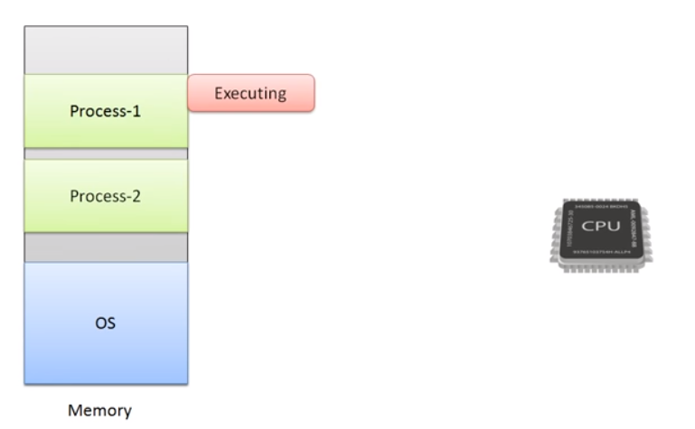
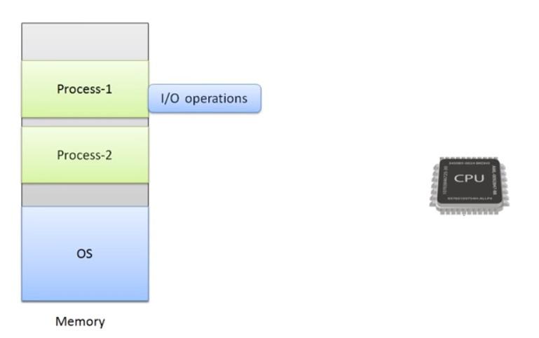
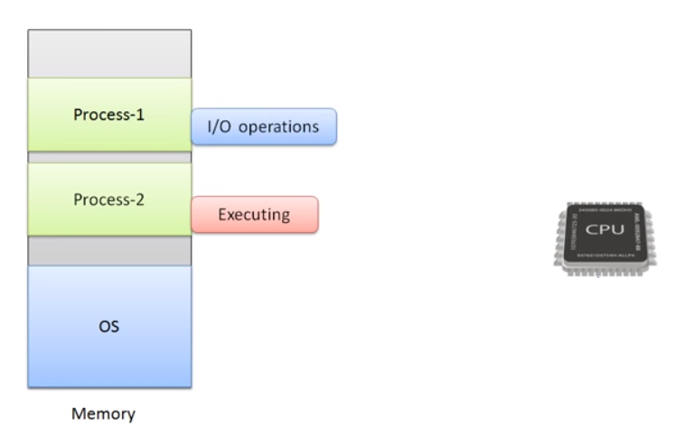
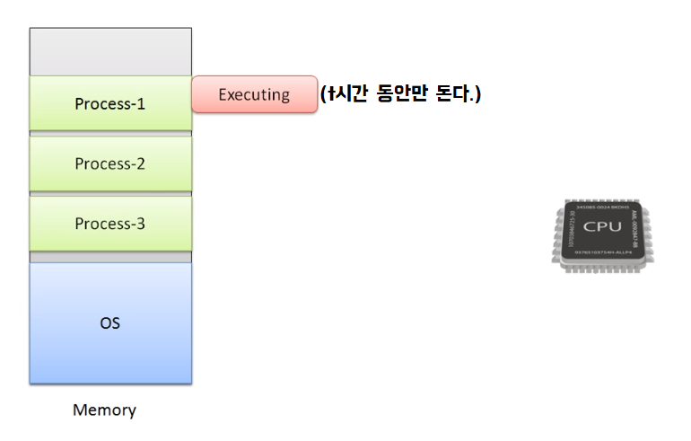
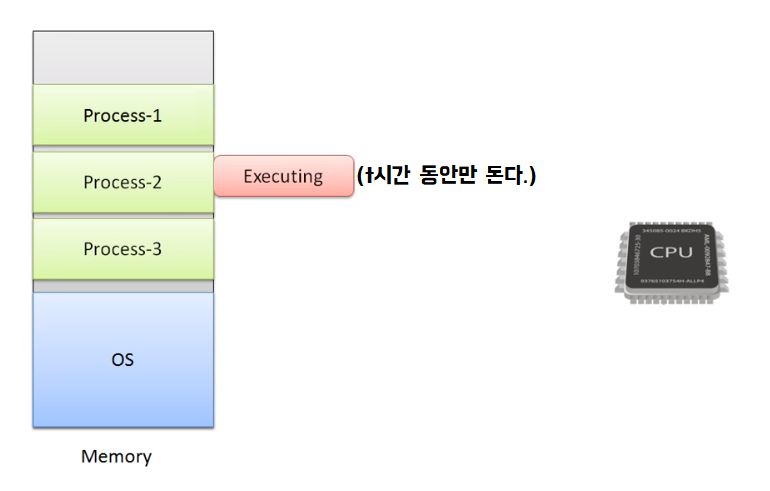
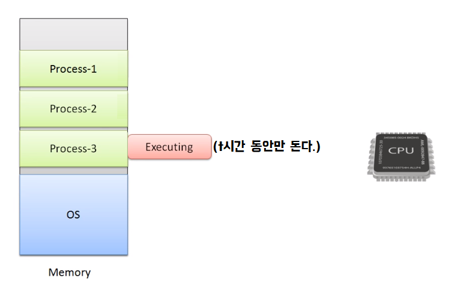
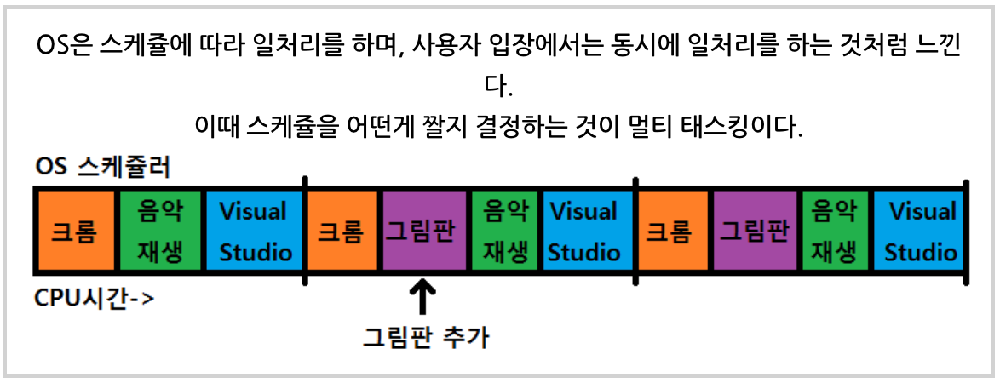
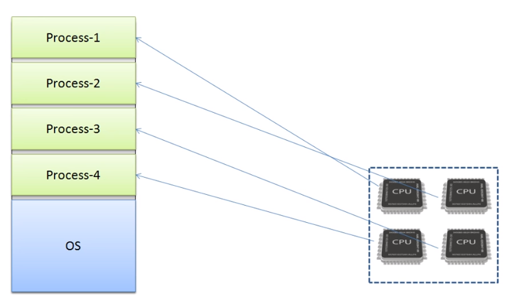
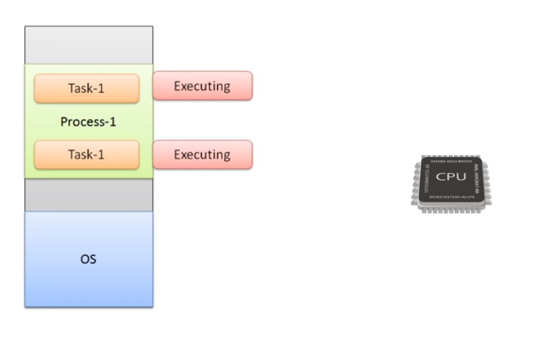
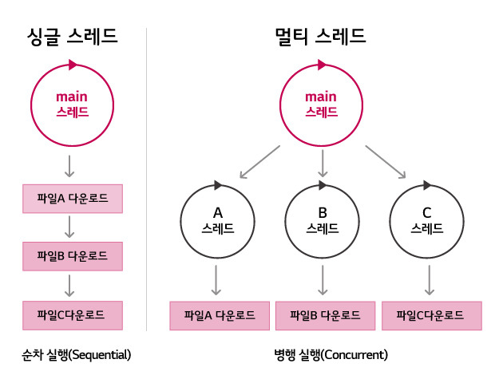

## 들어가기

**프로그램**

어떤 작업을 위해 실행할 수 있는 파일입니다.

ex) 메모장

**프로세스**

실행 중인 프로그램입니다.

**스레드**

실행 중인 프로그램 안에서 실행되는 명령어입니다.

ex) 특정 노래를 재생하는 스레드 및 새로운 노래를 재생 목록에 추가하기 위한 스레드

**멀티프로그래밍**

하나의 CPU 상에서 여러 프로세스가 동시에 실행되는 것을 의미합니다. 즉, 하나의 CPU가 I/O를 하게 되면 입출력에 대한 응답을 무한정 기다리게 되는데, 이렇게 대기하는 동안 프로세서가 다른 프로세스를 진행할 수 있도록 하는 방식입니다.

**멀티태스킹**

멀티태스킹은 스케줄러 알고리즘에 따라 조금씩 번갈아 가면서 프로세스가 수행되는 방식입니다. 멀티프로그래밍과의 차이는, 멀티프로그래밍은 하나의 프로세스가 I/O를 만나기 전까지 끝까지 실행되지만 멀티태스킹은 실행되는 도중에 특정 시간 이상 CPU를 점유하게 되면 다음 프로세스에게 프로세서 자원을 넘겨주는 방식이라는 점입니다.

**멀티프로세싱**

멀티프로세싱은 여러 프로세서 상에서 여러 프로세스가 동시에 실행되는 것을 의미합니다.

**멀티스레딩**

멀티스레딩은 하나의 프로세스에서 여러 스레드가 동시에 실행되는 것을 의미합니다.

실제로 한 번에 두 가지 일을 `동시에 병렬`로 처리하는 것이 아니라 번갈아 가며 처리하여 동시에 작업이 처리되는 것처럼 느끼게 하는 방식입니다.

ex) 채팅의 경우 - 멀티스레드를 사용하여 상대방의 메시지 다운과 입력을 동시에 처리.

**싱글스레드**

싱글스레드는 하나의 직렬로 처리하는 스레드 방식을 의미합니다. 즉, 하나의 요청이 있으면 그것을 처리할 때까지 다음 요청은 대기 상태입니다. (하나씩만 실행할 수 있습니다.)

ex) 채팅의 경우 - 상대방의 메시지를 다운받는 동안 입력할 수 없습니다.

